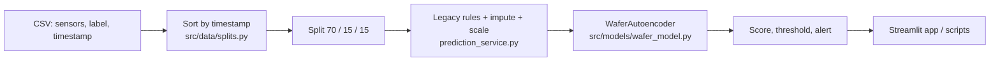

# WaferGuard — Wafer Defect Anomaly Detection

WaferGuard is an academic prototype that scores semiconductor wafer sensor records with a PyTorch supervised autoencoder and shows the results in a Streamlit app.

> **Status: NO-GO for production.** On a held-out test set with 9 defects, the models score only slightly better than chance, and an analysis of the data suggests the sensor signal does not hold up over time. See [AUDIT.md](AUDIT.md) for the evidence.

## Quick start

```powershell
cd A:\05_Wafer\wafer-guard
.\.venv\Scripts\Activate.ps1          # or create a venv and: pip install -r requirements.txt
python -m pytest                       # 23 tests on synthetic data
python src\evaluation\smoke_test.py    # 7 checks against the real artifacts
streamlit run app.py                   # then click "Run Model"
```

The dataset and model artifacts are not in Git. Place the dataset at `data/raw/secom_telemetry_modified.csv`; see [Artifacts](#artifacts) for the model files.

## Results at a glance

Test partition: the last 15% of rows (236 wafers, 9 defects, 3.81% prevalence). The test set has been inspected before, so every figure is **exploratory**.

| Model | ROC-AUC | Average precision | Defects caught | False alarms |
|---|---:|---:|---:|---:|
| Deployed autoencoder (472 features) | 0.747 | 0.096 | 1 of 9 | 12 |
| Notebook autoencoder (592 features) | 0.679 | 0.092 | 2 of 9 | 13 |

A model with no skill would score an average precision near the 3.8% prevalence. With nine defects, one extra catch moves recall by 11 points and the confidence intervals are wide. The full tables, confidence intervals and the reason these numbers are weak are in [AUDIT.md](AUDIT.md).

## How it works



1. **Split.** Rows are ordered by timestamp (stable sort) and cut chronologically: the earliest 70% train, the next 15% choose the checkpoint and threshold, the last 15% are the test set. The cut lives in `src/data/splits.py` and is shared by the notebook, the app and the scripts.
2. **Features.** `sensor_0 == 0.0` marks a legacy wafer; those rows get missing values for `sensor_0` and `sensor_1` plus four indicator columns. Everything else is median-imputed and standardised using training rows only.
3. **Model.** `WaferAutoencoder` reconstructs the features and has a classifier head on the latent layer; the sigmoid of that head is the defect score. A wafer is flagged when its score reaches the threshold.
4. **Serving.** The app and scripts load the saved model and preprocessor through `src/services/prediction_service.py`.

Terms are defined in [docs/glossary.md](docs/glossary.md).

## Dataset

`data/raw/secom_telemetry_modified.csv`: 1,567 records, 590 sensors, labels `-1` (normal) and `+1` (defect).

| Partition | Records | Defects | Defect prevalence |
|---|---:|---:|---:|
| Training | 1,096 | 78 | 7.12% |
| Validation | 235 | 17 | 7.23% |
| Test | 236 | 9 | 3.81% |
| **Total** | **1,567** | **104** | **6.64%** |

The saved model in `artifacts/` was trained under an earlier 70/10/20 split (first 70% for training), so the final 15% is also unseen by it. Do not commit private or restricted data.

## Artifacts

Two model versions can coexist; both load through the same code.

| | Deployed model | Notebook output |
|---|---|---|
| Files | `artifacts/wafer_model.pt`, `artifacts/preprocessor.joblib` | the same names, written by the notebook |
| Features | 472 | 592 |
| Threshold | 0.001003 | set for a 10% alert rate on each run |

A separate gradient-boosting candidate lives at `artifacts/experiments/wafer_guard_final_gb.joblib`; its threshold of 0.5 is a provisional placeholder.

Keys, feature layout and the two versions are documented in [docs/artifacts.md](docs/artifacts.md). The saved `preprocessor.joblib` originally lacked `sensor_cols` and `feature_cols`; they were added with `scripts/maintenance/repair_preprocessor.py` and the original is kept as `artifacts/preprocessor_before_metadata_fix.joblib`. The model weights and fitted imputer and scaler are unchanged.

### Regenerate artifacts and reports

| Goal | Command |
|---|---|
| Retrain the autoencoder and preprocessor | Run all cells of `notebooks/wafer_guard_fixed.ipynb` from a fresh kernel. It backs up existing artifacts as timestamped `.bak` files, then checks that the app reproduces its features, scores and alerts. Set `WAFERGUARD_ARTIFACT_DIR` to write elsewhere. |
| Add missing metadata to an older preprocessor | `python scripts/maintenance/repair_preprocessor.py` |
| Retrain the gradient-boosting candidate | `python scripts/training/train_model.py` |
| Evaluate the saved autoencoder on the test partition | `python scripts/evaluation/evaluate_model.py` |
| Write the gradient-boosting evaluation report | `python scripts/evaluation/generate_evaluation_report.py` |
| Threshold diagnostic on the validation partition | `python scripts/evaluation/validate_threshold.py` |

## Repository layout

| Path | Purpose |
|---|---|
| `app.py` | Streamlit app |
| `src/data/splits.py` | The single train/validation/test split definition |
| `src/models/wafer_model.py` | `WaferAutoencoder` |
| `src/services/prediction_service.py` | Loading, feature preparation and scoring; validates artifacts |
| `src/evaluation/smoke_test.py` | Standalone smoke test (7 checks) |
| `notebooks/wafer_guard_fixed.ipynb` | Training and evaluation workflow, outputs saved |
| `scripts/` | Training, evaluation and maintenance scripts |
| `tests/` | Pytest suite (synthetic data; no dataset or artifacts needed) |
| `reports/experiments/` | Saved experiment results |
| `archive/` | Retired experiments and earlier app versions (not maintained) |
| `docs/` | Artifact format and glossary |
| `AUDIT.md`, `CHANGELOG.md`, `CONTRIBUTING.md` | Audit evidence, change history, contribution rules |

## Verification status

- **Pytest:** 23 tests pass. They check the split, feature rules, model shapes and train/serve parity; they do not measure model quality.
- **Smoke test:** 7 of 7 checks pass against the saved artifacts.
- **Notebook:** executed end to end with outputs saved, including the parity check.
- **Production validation:** not established.

## Limitations

- Only nine defects are in the test partition, so every test metric is highly uncertain.
- Accuracy is misleading at about 4–7% prevalence; look at average precision, alert rate and false alarms.
- Sensor-defect relationships do not persist across time periods (see [AUDIT.md](AUDIT.md), section 5), and the defect rate drifts from over 12% early in the data to under 2% late.
- Scores rank wafers; they are not calibrated defect probabilities.
- Successful startup or passing tests does not show the model detects defects reliably.

WaferGuard remains an academic prototype, not a validated inspection system.
